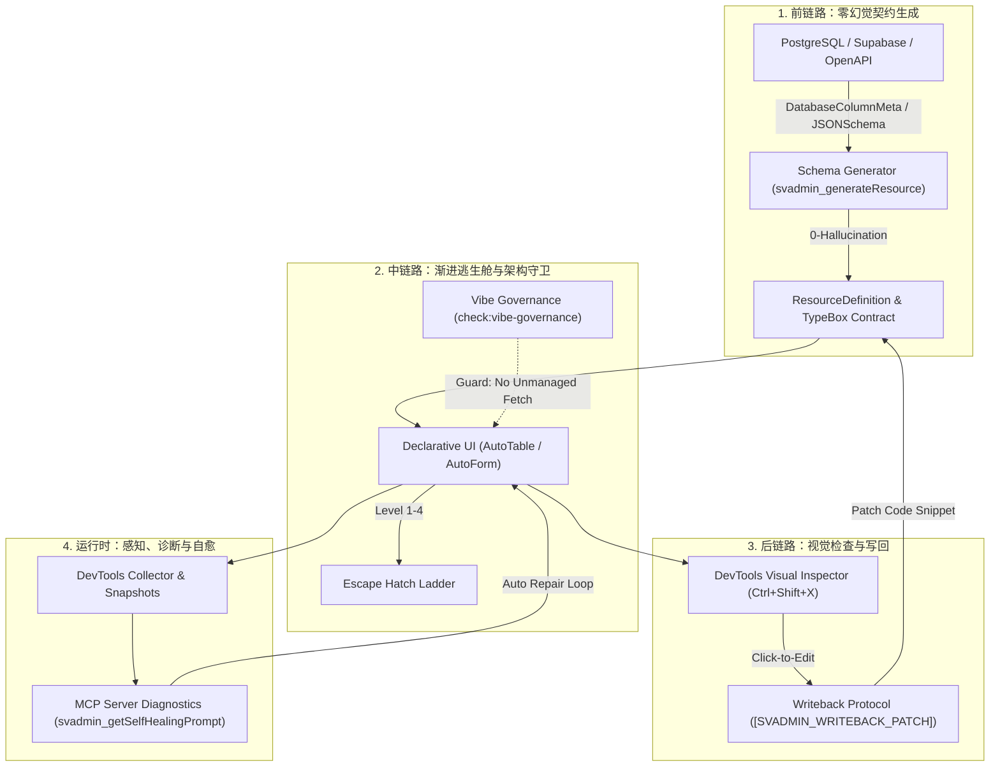

# SVAdmin: 工业级 Vibe Coding 全链路闭环架构 (The Complete Platform)

## 架构演进全景

为了将 SVAdmin 从“高效的后台管理脚手架”提升为“面向 AI Agent 时代具备生产级确定性”的 Vibe Coding 终极解法，本平台构建了覆盖研发全生命周期的四大核心闭环：

---

## 一、四大闭环技术实现详解

### 1. 前链路：零幻觉逆向 Schema 生成器（Schema Generator）
- **核心模块**：`@svadmin/core/inferencer-schema` 与 `@svadmin/mcp`
- **能力**：
  - `inferFromDatabaseColumns`: 逆向推导 SQL / PostgreSQL 数据类型（含 Bigint, Timestamptz, JSONB, UUID），自动标定 Primary Key、Foreign Key 关联关系与默认约束。
  - `inferFromJSONSchema`: 逆向推导 OpenAPI 3.0 / JSON Schema 对象，自动将 `format: 'email' | 'uri' | 'date-time'` 映射至高阶组件类型，将 `enum` 转化为 `select` 配置。
  - MCP 工具 `svadmin_generateResource`：Agent 一键直接生成包含 TypeBox 契约、Svelte 5 Snippets 与 Resource 定义的完整代码包。

### 2. 中链路：4 级渐进逃生舱与架构守卫（Escape Hatches & Governance）
- **4 级阶梯心智**：
  - **Level 1 (Schema-driven)**：100% 声明式，AI 修改成本为 1 行配置。
  - **Level 2 (Snippet 插槽)**：`AutoForm.fields` 与 `AutoTable.columns` 精准插槽定制，避免“改一个字段重写整张表”。
  - **Level 3 (Headless 拼装)**：`useTable` / `useForm` 纯逻辑拼装。
  - **Level 4 (纯底层 Hooks)**：`useList` / `useOne` 原生状态。
- **架构守卫（Governance Linter）**：
  - 脚本：`bun run check:vibe-governance`（或 MCP 工具 `svadmin_verifyGovernance`）。
  - 强制规约：严禁在视图层直连 `fetch`，严格隔离 Data Provider；对 Level 3/4 逃生舱要求提供 `// @vibe-escape` 理由注解。

### 3. 后链路：Visual Inspector 与修改直接写回（Writeback Protocol）
- **元素精准标定**：所有核心组件注入 `data-svadmin-component`、`data-svadmin-resource` 与 `data-svadmin-field`。
- **写回协议**：
  - Inspector 点击触发 `svadmin:vibe-patch` 自定义事件。
  - 自动向系统剪贴板注入携带结构化元数据的 `[SVADMIN_WRITEBACK_PATCH]` 提示词。
  - MCP 工具 `svadmin_applyResourcePatch` 为 Agent 提供针对目标文件的即时 AST 级 Patch 代码片段。

### 4. 离线零配置沙箱（Zero-Config Mock Data Provider）
- **核心模块**：`@svadmin/core/mock-provider`
- **能力**：
  - 开箱即用预置企业级数据集合（Users, Posts, Orders, Audit Logs）。
  - 原生支持客户端过滤、多字段排序、分页与完整 CRUD 事务。
  - Agent 在脱离真实后端与网络时仍可秒级启动完整验证。

---

## 二、MCP 工具矩阵清单

| 工具名 | 模式 | 描述 |
| :--- | :--- | :--- |
| `svadmin_generateResource` | Read-only | 从 Sample / JSON Schema / SQL 列元数据生成完整 Resource 定义与 UI 代码 |
| `svadmin_applyResourcePatch` | Read-only | 计算视觉 Inspector 点选操作的代码变更 Patch 与 Agent 提示词 |
| `svadmin_verifyGovernance` | Read-only | 执行 Vibe Coding 架构合规性自审（数据流隔离与逃生舱纪律） |
| `svadmin_getDiagnostics` | Read-only | 获取运行时 Provider 状态、资源注册矩阵与错误事件 |
| `svadmin_getSelfHealingPrompt`| Read-only | 提取运行时报错，输出结构化根因分析与代码自愈提示词 |
| `svadmin_getManifest` | Read-only | 获取当前应用架构全貌清单与能力集 |
| `svadmin_getList` / CRUD | Data | 标准化数据层 CRUD 工具 |
