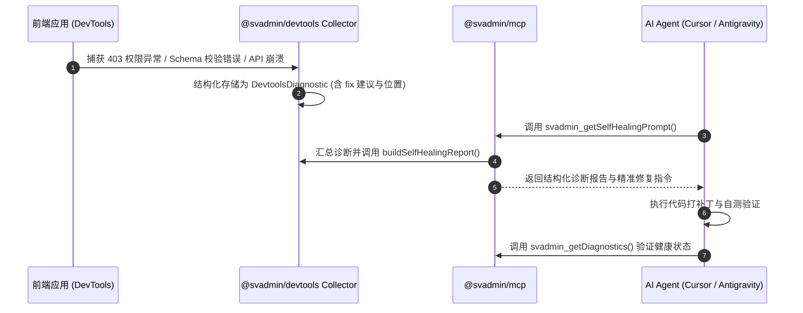

# SVAdmin Vibecoding 运行时反馈与自愈闭环协议

> 本文档规范 SVAdmin 面向 Vibecoding 的两大核心交互闭环：**视觉反馈与点选编辑（Visual Inspector Loop）**，以及 **DevTools 到 MCP 的运行时自愈闭环（DevTools -> MCP Self-Healing Loop）**。

---

## 一、 闭环 1：即时视觉反馈与点选编辑（Visual Inspector）

### 1. 架构目标
让前端用户/开发者在浏览器中不仅能“看页面”，而且能通过**鼠标点选**直接将界面元素反向映射为精确的“AI 意图 Prompt”，打通从“界面视觉”到“Agent 代码编写”的零心智鸿沟。

### 2. DOM 元数据属性注入（Inspection Contract）
框架渲染组件在开发环境下自动注入以下属性：
- **`data-svadmin-component`**：组件类型（如 `AutoTable`、`AutoForm`）
- **`data-svadmin-resource`**：当前绑定的业务资源名（如 `orders`、`users`）
- **`data-svadmin-field`**：当前表格列或表单字段 Key（如 `status`、`price`）
- **`data-svadmin-field-type`**：字段的数据类型（如 `text`、`number`、`select`）

### 3. DevTools 点选交互
- **快捷键**：`Ctrl + Shift + X`（或在 DevTools 标题栏点击 `Crosshair` 图标）进入点选检查模式；
- **高亮渲染**：悬停时在元素周围绘制定位虚线框与半透明遮罩，并显示组件与字段标签；
- **动作执行**：
  - 点击元素：自动将精确的 Vibe 提示词拷贝到系统剪贴板（如：`在 svadmin 中修改资源 'orders' 的 <AutoTable> 组件：为字段 'status' 定制显示与交互效果。`）；
  - 广播事件：向全局派发 `CustomEvent('svadmin:vibe-inspect', { detail })`，供插件或 Agent 监听。

---

## 二、 闭环 2：DevTools -> MCP 运行时自愈协议（Self-Healing Loop）

### 1. 运行自愈流程

### 2. `@svadmin/devtools` 核心方法
- **`captureRuntimeError(error, context)`**：将任意运行时 Error 或 API 返回归类为结构化诊断；
  - 类别：`PERMISSION_DENIED` | `SCHEMA_MISMATCH` | `NETWORK_ERROR` | `RUNTIME_EXCEPTION`
  - 产出：含 `code`、`severity`、`fix.suggestedAction` 的标准 `DevtoolsDiagnostic`；
- **`buildSelfHealingReport(diagnostics)`**：汇总分析所有未解决的错误，生成直观的 Markdown + JSON 自愈报告，以及直接可交付给 LLM 修复代码的 `agentPrompt`。

### 3. `@svadmin/mcp` 自愈工具集成
| 工具名 | 模式 | 描述 |
| :--- | :--- | :--- |
| **`svadmin_getDiagnostics`** | 只读 | 获取当前应用的健康状态、Provider 配置矩阵及运行时事件快照 |
| **`svadmin_getSelfHealingPrompt`** | 只读 | 提取最新的运行时异常与堆栈，生成可直接执行的排障与修复指令 |
| **`svadmin_getManifest`** | 只读 | 导出当前所有激活资源的 Schema、字段与能力定义，免去 Agent 盲目扫库 |
