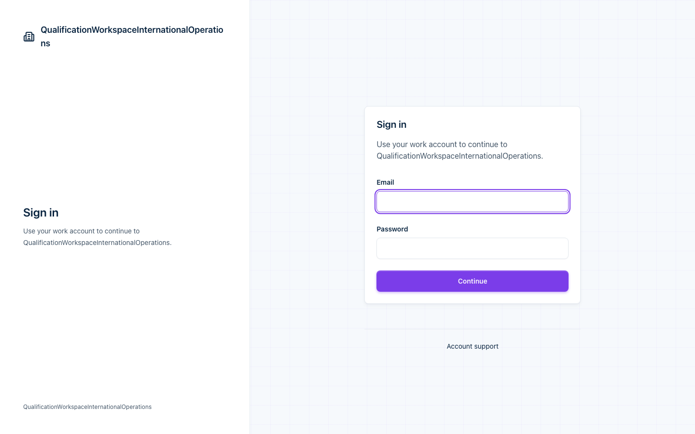
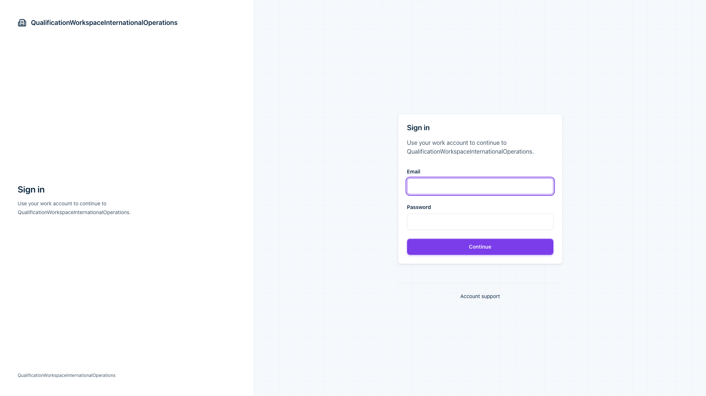
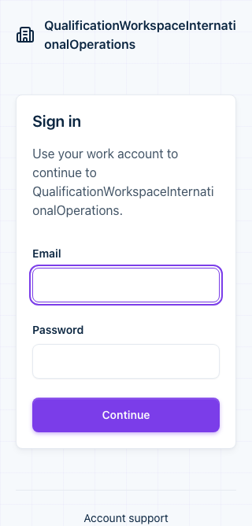
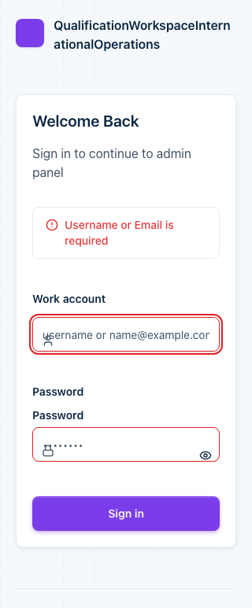

# 认证页面品牌与无障碍验收

## 任务约定

- parent/source：五项目标验收收口，承接 #529；用户 2026-10-21 的“继续”请求。
- reason：主线已包含品牌插槽和登录文案钩子；#511 仅合入品牌分支，认证区域关联与响应式保护未进入主线。
- 目标：认证区域具有实例独立的可访问名称和说明；长品牌文案在桌面与窄视口完整折行，保留键盘操作与焦点环。
- 非目标：认证协议、真实身份服务、登录业务流程重写、主题重设计、全仓扫描、npm 发布或生产部署。
- 范围：AuthPageShell、其专属样式和聚焦测试、受控浏览器 fixture、五项目标验收文档。
- 风险/委派：共享认证壳的中风险修复；managed，一个写入者和一个独立只读复核者。
- 执行状态：验证中。当前记录不是生产验收。

## Gherkin 验收

```gherkin
Given 认证壳提供标题和可选说明
When 渲染、更新文案或移除说明
Then 认证区域引用自身标题和当前说明，不保留悬空引用

Given 同页渲染两个认证壳
When 读取每个区域的可访问名称和说明
Then 引用只指向各自实例内的元素，不出现重复 ID

Given 默认品牌或自定义品牌包含长连续文本
When 在桌面、窄视口和明暗主题下展示
Then 仅对应视口的品牌区可见，文案完整折行，控件与焦点环不被裁剪

Given 用户只使用键盘访问认证内容
When 按 Tab 和 Shift+Tab 移动并提交缺少凭据的登录表单
Then 焦点顺序与 DOM 一致，错误可访问且关联输入，填写内容后可继续操作
```

## 验证边界

浏览器使用当前组件源码与仓库样式、合成品牌和受控认证 Provider。
不发送真实凭据，不证明任何生产身份服务可用，也不将历史截图视为本轮重跑。

## 本轮验证

- `TMPDIR=/tmp bun run --cwd packages/ui test auth-page-shell.test.svelte.ts --maxWorkers=1`：6/6。
- `TMPDIR=/tmp bun run --cwd packages/ui test app-css.test.ts --maxWorkers=1`：14/14。
- `TMPDIR=/tmp bun run --cwd packages/ui test component-color-tokens.test.ts --maxWorkers=1`：4/4。
- `CHROMIUM_PATH=... AUTH_SHELL_EVIDENCE=docs/evidence/auth-page-shell node --test packages/ui/scripts/auth-page-shell.browser.test.mjs`：24/24。
- 浏览器组合：`1440x900`、`1920x1080`、`390x844`、`320x640`；明色/暗色；默认品牌、自定义品牌、真实 `LoginPage`。
- 所有组合：无页面异常、无文档横向溢出，所检查的容器/控件无横向越界；认证区域标题/说明引用有效，标题字号为 `20px`。
- `auth-contract.test.svelte.ts`：9/9；覆盖内置认证页面与受控适配器契约。
- 改动文件 ESLint：通过。
- 暗色夹具同步宿主 `svadmin-theme`、`dark`、`svadmin-theme-dark`，并采样实际背景与品牌文字明暗，避免只切换根类而产生视觉假通过。最终 24 个组合已重跑。
- 品牌检查直接读取可见文字的完整内容、行框、容器边界与双向 scroll 尺寸；错误检查验证首次校验文案及账号/密码输入在错误后的焦点保留。
- `git diff --check`：通过。
- 机器结果见 [browser-report.json](./browser-report.json)。

## 保留事项

- `login-error-320x640.png` 中密码标签重复、账号图标间距偏紧是主线既有问题，本轮没有修改 `LoginPage` 或 `PasswordInput`。不把容器溢出检查当成这些控件内部视觉问题的通过证据。
- 主题采样用于确认明暗夹具确实生效，不是 WCAG 对比度审计；未覆盖读屏器、所有品牌资源、语言、浏览器引擎或认证页面状态。
- 外部身份服务、发布和部署不在任务验收范围，不作为本地源码任务继续扩展的理由。

## 截图








