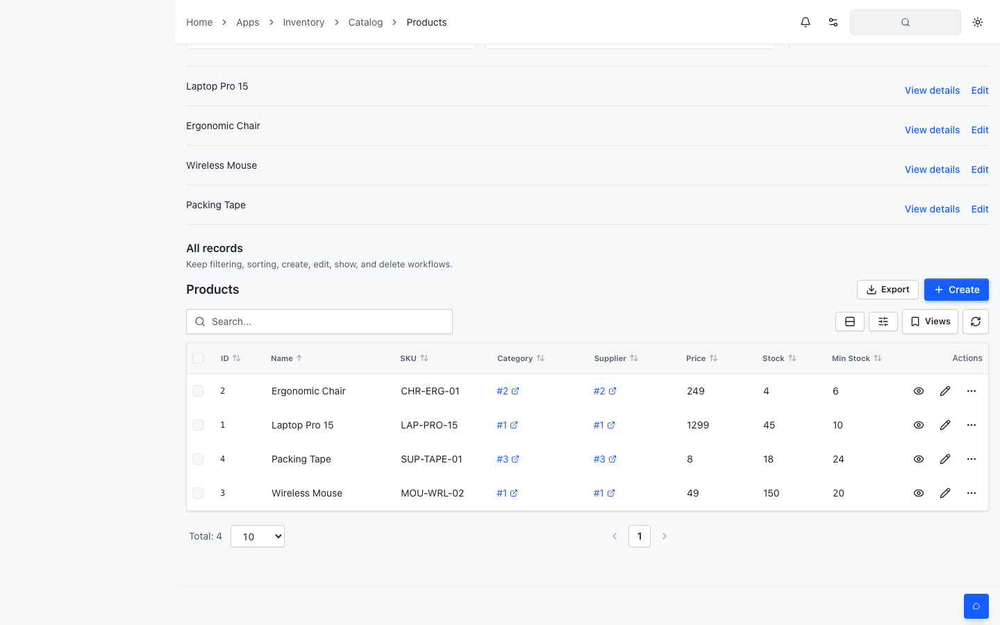
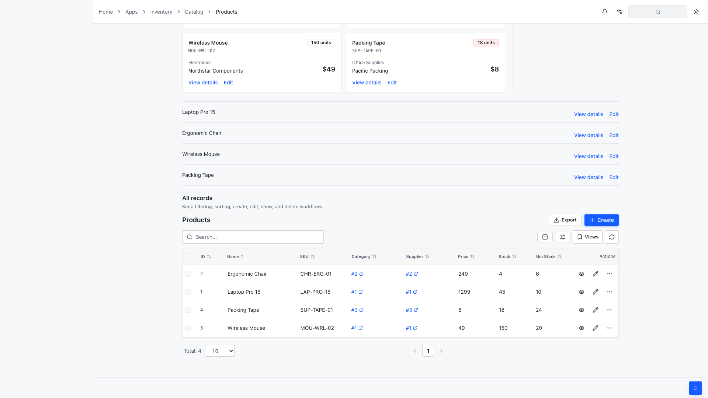

# AutoTable 响应式可见性证据

本次修复验证了 UI 与 AI 样式同时加载时，AutoTable 的桌面表格和移动卡片不会被通用 `.hidden` 规则互相覆盖。

## 状态矩阵

| 视口 | 记录视图 | 结果 |
| --- | --- | --- |
| 767px | 移动卡片可见，桌面表格隐藏 | 通过 |
| 768px | 桌面表格可见，移动卡片隐藏 | 通过 |
| 1280px | 桌面表格可见，移动卡片隐藏 | 通过 |

业务渲染浏览器测试在 1440x900、1920x1080 下均通过，并保存了当前修复后的真实页面截图。

