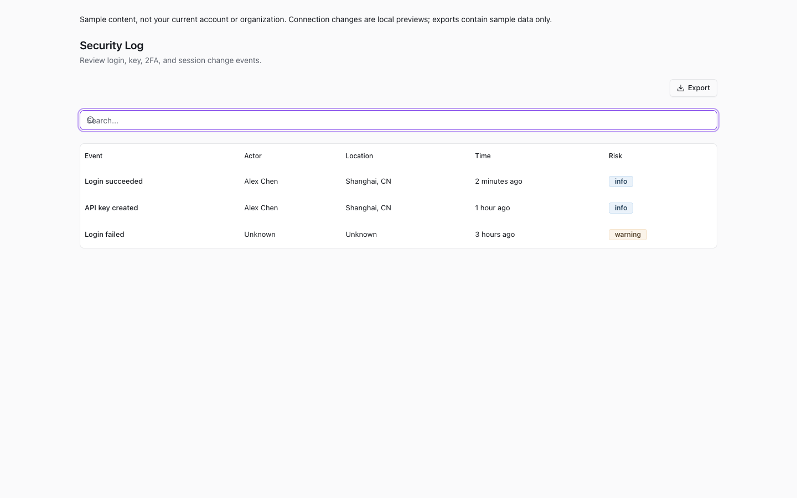
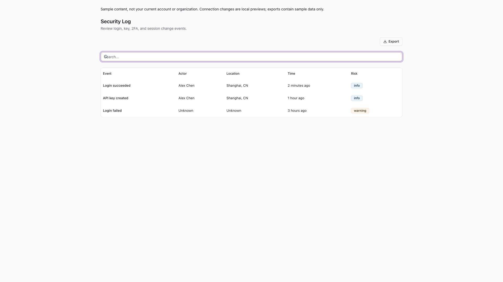
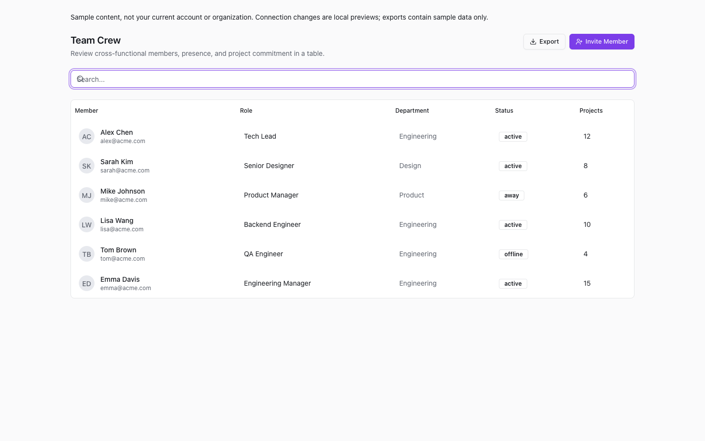
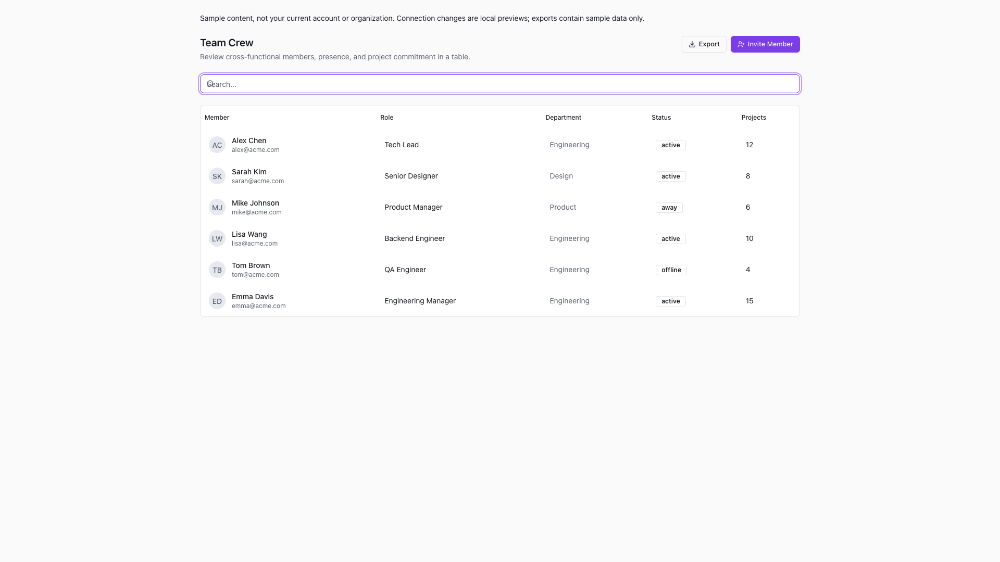

# 筛选栏清除搜索焦点恢复

## 任务约定

- parent/source：成员目录筛选恢复 PR #526；用户继续优化界面的请求。
- reason：公共 FilterToolbar 已有清除按钮，但清除后按钮卸载，键盘焦点未返回搜索输入。
- 目标：鼠标或键盘清除搜索后直接继续输入，同时保留高级筛选、宿主绑定及其他筛选栏的状态。
- 非目标：不增加页面级重复按钮，不修改数据请求、导出、权限、主题或公共组件 API。
- 风险：共享组件的中风险交互修复。
- 委派决策：缺少完整 native 能力证据，使用 managed；一个写入者和一个独立只读复核者。
- 范围补充：浏览器验证发现按钮通用按下动画覆盖清除按钮的居中 transform，造成点击失效；在 page-chrome.css 内将该按钮改为上下定位加自动边距居中，不改其他控件或动画。

## Gherkin 验收

```gherkin
Given 搜索词非空，搜索输入持有焦点
When 用户按 Tab 聚焦清除按钮，并按 Enter 或 Space
Then 搜索词清空，按钮消失，焦点返回搜索输入，可立即输入新的搜索词

Given 搜索词非空且清除按钮显示在输入框右侧
When 用户用鼠标点击清除按钮
Then 点击不被输入框覆盖层拦截，搜索词清空且焦点返回搜索输入

Given 页面同时展示两个筛选栏
When 用户通过鼠标清除第二个筛选栏的搜索词
Then 仅第二个输入清空并获得焦点，第一个搜索词保持不变

Given 高级筛选已展开且已填写筛选内容
When 用户清除搜索词
Then 宿主 query 绑定同步清空，高级筛选仍展开且内容保留

Given 筛选栏设置为不显示搜索
When 渲染仅含操作的筛选栏
Then 不创建搜索输入或清除按钮
```

## 验证

- `bun run --cwd packages/ui test filter-toolbar.test.svelte.ts`：9/9 通过。
- `node output/playwright/filter-toolbar/verify.mjs`：Chromium 6 个场景通过。
- `git diff --check`：通过。
- 独立只读复核：组件绑定及交互测试未发现阻断问题。
- 页面验收使用实际安全日志和团队成员参考页面，不代表真实服务或生产环境验收。

## 状态矩阵

| 视口 | 公共筛选栏 | 安全日志参考页 | 团队成员参考页 |
| --- | --- | --- | --- |
| 1440x900 | 通过 | 通过 | 通过 |
| 1920x1080 | 通过 | 通过 | 通过 |

每个场景均验证鼠标点击、Tab/Enter、Tab/Space、清除后继续输入及再次清除。
参考页清除后恢复原列表行数；公共筛选栏额外检查多实例隔离和高级筛选内容保留。
所有场景均无页面异常、无额外下载或导航、无横向页面溢出。
自动化结果见 [browser-report.json](./browser-report.json)。

## 截图

截图记录清除搜索后输入框重新获得焦点的状态，不表示参考页面的其他视觉问题也已处理。








