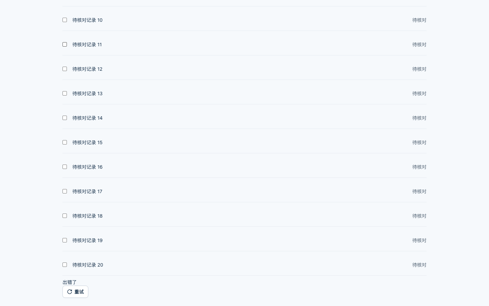
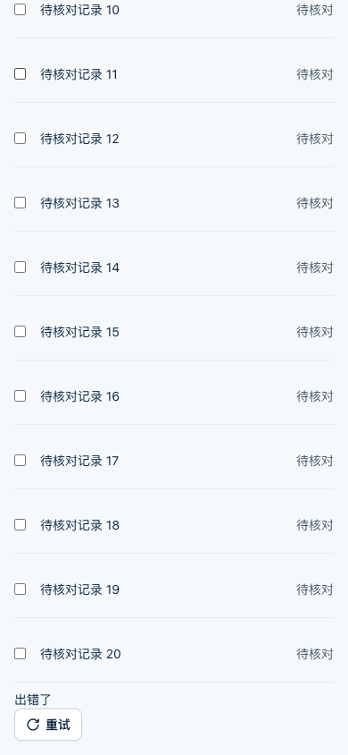

# InfiniteList 追加失败恢复验收

日期：2026-10-21。基线 HEAD：`51ce56238061ede8a3ee3e882f6799a5d896440c`，
含本线程未提交的 InfiniteList、查询反馈实现。不是该提交的发布验收。

## 范围与场景

管理员继续浏览记录时，追加页失败不能清空已有记录和选择，也不能因滚动
重复发请求。只请求失败范围；首屏错误仍重新请求首页。

| 场景 | 当前证据 |
| --- | --- |
| 追加失败、再次失败、恢复 | 1440x900、1920x1080、390x844，分别测试内置 Toast 与自定义通知 Provider |
| 保留内容与选择 | 已加载第一行 DOM 标记和勾选在失败、再次失败、重试中及恢复后均保留 |
| 滚动不会自动重试 | 失败后上下滚动，再回到底部，请求仍为 `[1,2]` |
| 键盘恢复 | 聚焦重试，Enter 激活；最终页序列严格为 `[1,2,2,2]` |
| 首屏失败 | 没有旧记录；Enter 重试后的页序列为 `[1,1]` |
| 初始空态 | 显示“暂无数据”，不显示错误或伪造记录 |
| 租户切换 | 追加重试挂起时切换租户；旧请求成功后仍只显示新租户记录 |

9 个浏览器场景通过。检查阶段未出现 `pageerror`、console error/warning、
重复通知或原始错误泄露；6 个追加恢复组合均断言无文档横向溢出。
截图保存于失败态，证明旧记录和重试控件同时存在，不是重新渲染出来的空列表。

## 可复现入口

- 受控 Provider 夹具：`output/playwright/infinite-recovery-20261021/Fixture.svelte`
- 自动交互：同目录 `verify.js`，通过 `playwright-cli run-code --filename` 执行。
- 本机浏览器配置复用 `output/playwright/notification-settings/cli.config.json`，
  使用已安装 Chromium，不安装依赖、不连接外部业务服务。
- 本地预览：`http://127.0.0.1:5187/`。
- 使用当前组件源码与本轮重新构建的 `packages/ui/dist/app.css`。

CLI 从 `/tmp` 执行，避免 npm 解析本仓库 Bun 专用 override 时报
`EINVALIDTAGNAME`；未修改锁文件或 override。初次手动检查的 favicon 404
已通过夹具声明空 favicon 解决，最终 9 场景重新运行无该错误。

2026-10-21 在当前未提交工作区重新执行了直接相关的消费者回归：

- `packages/ui/src/components/query-feedback-ownership.test.svelte.ts`：19/19
- `packages/core/src/query-source.test.svelte.ts`：165/165
- `packages/core/src/query-session-lifecycle.test.svelte.ts`：5/5
- `example/test/pm-business-pages.test.ts`：31/31

以上测试逐文件执行并均退出码 0，覆盖查询反馈归属、通知 key 隔离、
查询销毁、追加页/主查询恢复，以及 Domain、Operations、AutoTable 消费者的
局部失败重试。续接时的首次测试启动因临时目录 `ENOSPC` 中断，未执行用例；
磁盘空间恢复后才取得上述结果，未更改断言或清理用户文件。
`svelte2tsx` source map 缺失和 Node localStorage 提示仍存在，未导致重跑失败。
前述浏览器证据仅对应 InfiniteList 合成夹具，本次没有重新执行浏览器或 SVAR
专项，不能把包内结果外推为完整应用或生产服务验收。
InfiniteList 契约及类型的 52/52 是上一轮记录，本次未重跑。
旧请求迟到失败、契约非法记录、同一事件循环双击和排队 observer 回调的确定性
边界仍由上述单元测试负责；本次浏览器只验证表中所列路径。

## 截图与边界

已检查下列桌面和手机错误态截图：记录、复选框和底部重试可辨认，没有遮挡。
完整 6 张截图及脚本保留在忽略目录，以下两张作为本次持久证据。

这是受控合成数据夹具，不是生产页面、完整应用或服务端权限认证。
没有修改权限策略、提交、推送、发布或部署。整体企业级目标仍需逐项验收，
本页仅关闭 InfiniteList 的这组浏览器恢复证据缺口。
