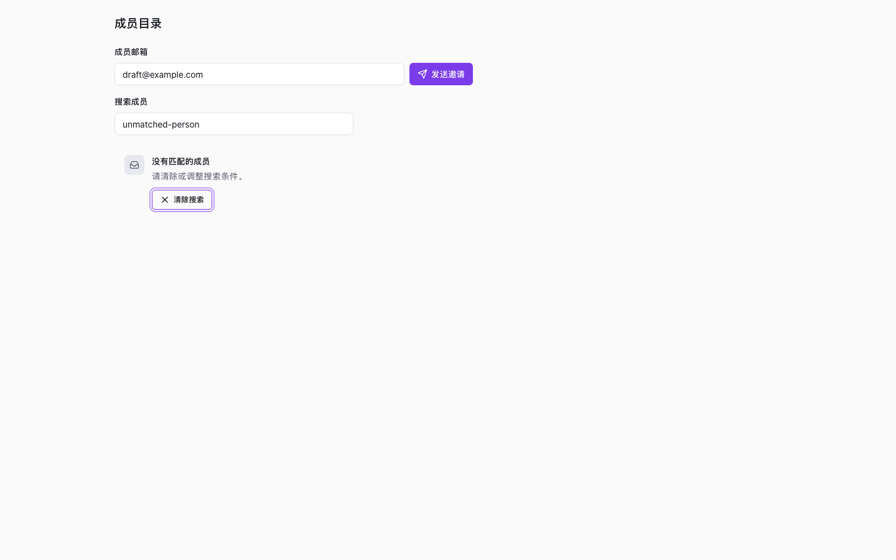
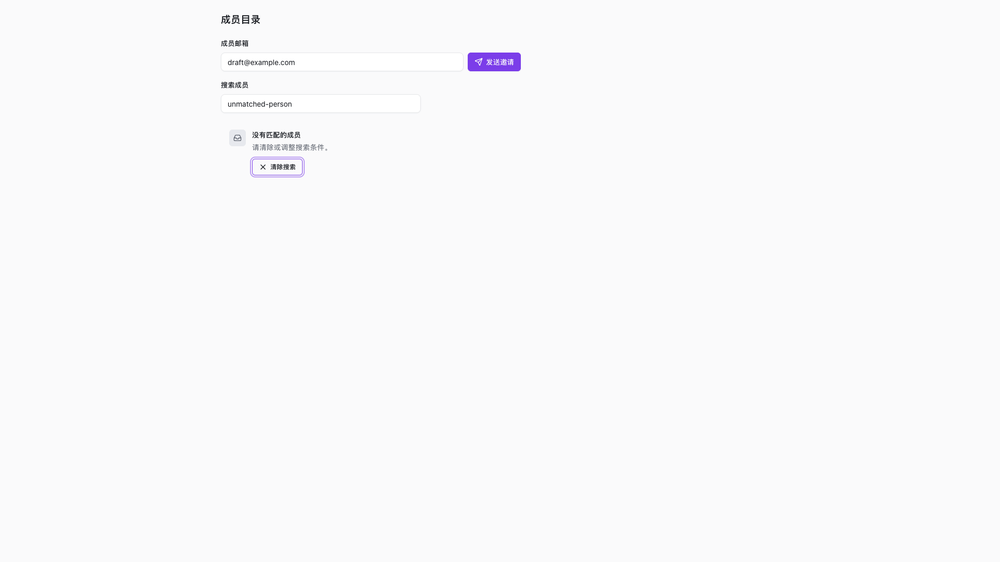

# 成员目录筛选恢复验收

## 范围

为成员目录的筛选空态补充“一键清除搜索”恢复动作。
清除后恢复列表并将焦点送回搜索框；不重新请求目录、不清除邀请草稿、不改变只读目录能力。
首次空目录仍使用普通空态，不展示筛选恢复按钮。

## Gherkin 验收

```gherkin
Given 成员目录已加载且搜索没有匹配项
When 用户通过 Tab 和 Enter 激活“清除搜索”
Then 搜索值清空，成员列表恢复，焦点回到搜索框

Given 邀请表单已有草稿
When 用户清除成员搜索
Then 邀请草稿保留，目录只读/可邀请能力不改变

Given 成员目录首次返回空列表
When 用户输入搜索词
Then 仍展示首次空态，不伪装成筛选空态，也不展示清除按钮
```

## 验证结果

- `bun run --cwd packages/ui test builtin-pm-repairs.test.svelte.ts`：18/18 通过。
- `bun run --cwd packages/ui test component-color-tokens.test.ts`：4/4 通过。
- `bun scripts/ui-state-evidence-check.ts`：通过。
- 真实 Chromium：1440x900、1920x1080，各覆盖可邀请、只读、首次空目录。
- 浏览器流程验证 Tab/Enter 焦点恢复、邀请草稿保留、请求只执行一次、无页面异常和横向溢出。

截图使用当前组件源码、现有 CSS 和受控目录 Provider，不代表真实目录服务或生产验收。




