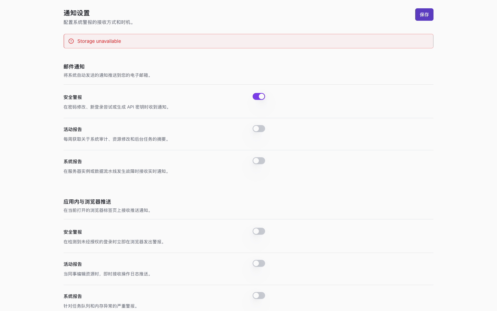
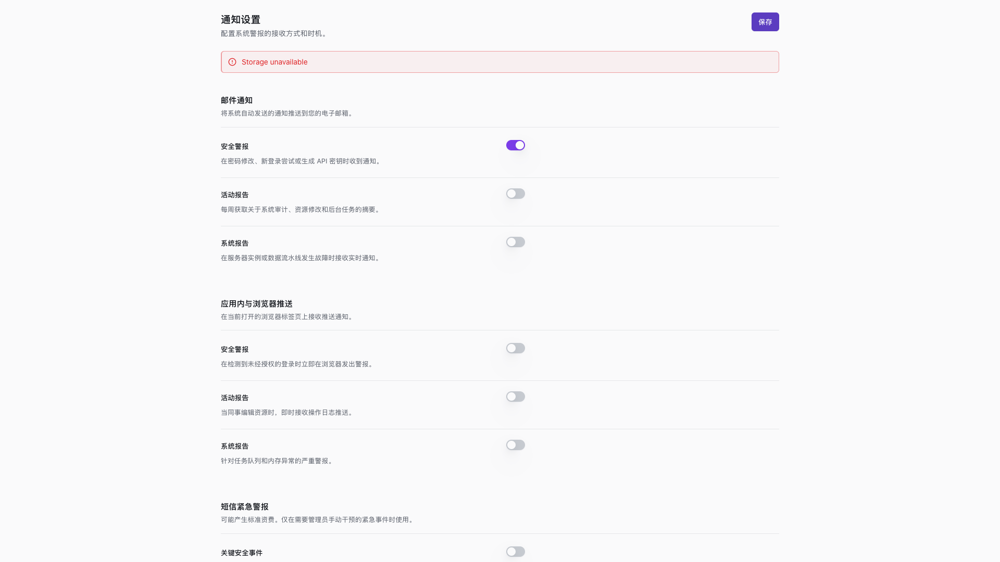

# 通知设置恢复状态验收

## 范围

本轮承接 #523 的状态契约完善，仅修改通知偏好组件及其聚焦测试。
目标：管理员在读取失败后可以重试，在保存失败后保留当前编辑值并手动再次保存。
不修改 Provider API、权限、存储格式、真实通知渠道或其他业务页面。
低风险，单作者实施与确定性验证；不扩展并行核心查询任务。

## 状态矩阵

| 状态 | 呈现 | 恢复及字段行为 |
| --- | --- | --- |
| 加载中 | DataState 骨架 | 隐藏未加载开关，禁用保存 |
| 加载失败 | DataState 错误与重试按钮 | 重试重新读取，成功后显示七个开关 |
| 已加载 | 原有设置分组 | 可编辑及保存 |
| 保存失败 | 单一 danger FeedbackNotice | 保留开关值，不重载、不自动重复保存 |
| 再次保存成功 | 清除错误反馈 | 保留当前开关值 |
| 未配置 Provider | 原有配置警告 | 设置仍可见，但开关和保存禁用 |

不涉及折叠容器，没有新增空数据语义。

## Gherkin 验收

```gherkin
Given 通知偏好尚未返回
When 页面等待加载
Then 只显示加载状态且保存不可用

Given 首次读取失败
When 用户以 Enter 激活重试
Then 重新读取并在成功后显示七个开关

Given 用户修改开关且首次保存失败
When 用户再次点击保存
Then 使用保留的编辑值保存且移除错误反馈
And 不自动重复提交或重新加载偏好

Given 没有配置通知偏好 Provider
When 用户进入设置
Then 保留配置警告和禁用设置
```

## 验证结果

- `builtin-pm-repairs.test.svelte.ts`：15/15 通过。
- `git diff --check`：通过。
- 真实 Chromium 在 1440x900、1920x1080 均完成加载、失败重试、编辑、保存失败、再次保存、未配置状态流程。
- Enter 重试及 Space 切换通过；无页面 JavaScript 异常或横向溢出。
- 两张保存失败态截图已人工检查，标题、提示、按钮和开关没有重叠。

截图使用当前组件源码、现有构建 CSS 和受控测试 Provider，不是生产系统或完整应用外壳截图。
英文错误内容是夹具输入；不代表新增的用户界面翻译。
本地夹具、浏览器脚本及完整结果保存在忽略目录 `output/playwright/notification-settings/`。
未运行全量测试、未等待远程 CI，不代表包发布、部署或真实通知服务验收。




