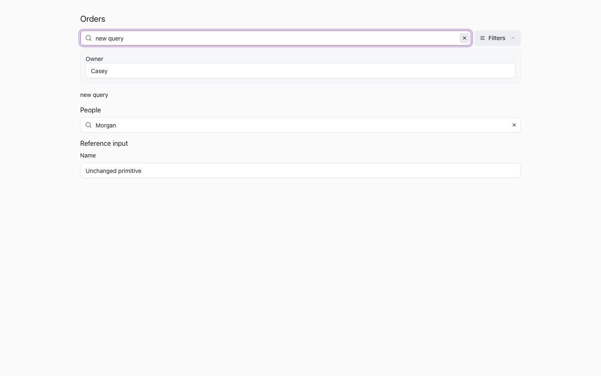
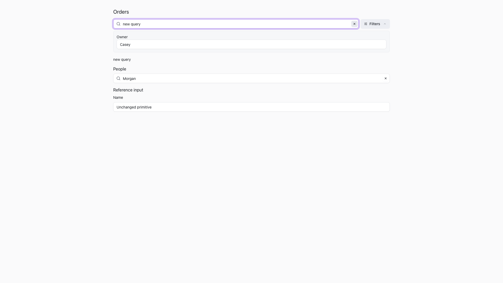

# 筛选栏文字与图标间距

## 任务约定

- parent/source：PR #527 后续浏览器验收；用户要求继续完成原始界面优化目标。
- reason：普通输入框的后置 padding 声明覆盖筛选栏声明，搜索文字与搜索图标重叠。
- 范围：仅调整筛选栏输入的选择器优先级，保留设计令牌、普通输入及宿主覆盖能力。
- 委派：managed，一个写入者和一个独立只读复核者。
- 不处理其他任务正在修改的共享工作树，也不执行发布或部署。

## Gherkin 验收

```gherkin
Given 公共筛选栏使用实际 app.css，页面为明色或暗色
When 用户输入搜索词
Then 搜索文字与搜索图标、清除按钮都保留可见间距

Given 页面使用 LTR 或 RTL 方向
When 鼠标或 Tab + Enter/Space 清除搜索
Then 搜索值清空、焦点恢复，并可继续输入

Given 宿主覆盖控件高度和间距令牌
When 页面应用这些令牌
Then 输入框更新尺寸，文字和图标不重叠，清除按钮仍在输入框内部

Given 同页有普通输入和第二个筛选栏
When 清除第一个搜索
Then 普通输入内边距、第二个搜索、高级筛选值均保持不变
```

## 验证

- `bun run --cwd packages/ui build:tailwind`：通过。
- `CHROMIUM_PATH=... node --test packages/ui/scripts/page-chrome.browser.test.mjs`：1/1 通过，覆盖 8 个视口/方向/主题组合，每个组合都验证默认与宿主令牌覆盖后的布局。
- `page-chrome-css.test.ts`：6/6 通过（与组件测试同批执行，整批因后者遇到 `ENOSPC` 返回失败）。
- `git diff --check`：通过。
- 首次组件回归因磁盘空间耗尽触发 `ENOSPC`；随后运行 `TMPDIR=/tmp bun run --cwd packages/ui test filter-toolbar.test.svelte.ts --maxWorkers=1`，9/9 通过。
- 截图与自动化结果见本目录；页面使用真实组件源码和受控 fixture，不代表生产数据服务验收。

## 状态矩阵

| 视口 | 明色 LTR | 暗色 LTR | 明色 RTL | 暗色 RTL |
| --- | --- | --- | --- | --- |
| 1440x900 | 通过 | 通过 | 通过 | 通过 |
| 1920x1080 | 通过 | 通过 | 通过 | 通过 |

修复前左右间距均为 -15px（重叠）；修复后均为 9px。
每个组合还验证 44px 控件高度和 16px 间距令牌覆盖，不固定宿主的尺寸。




