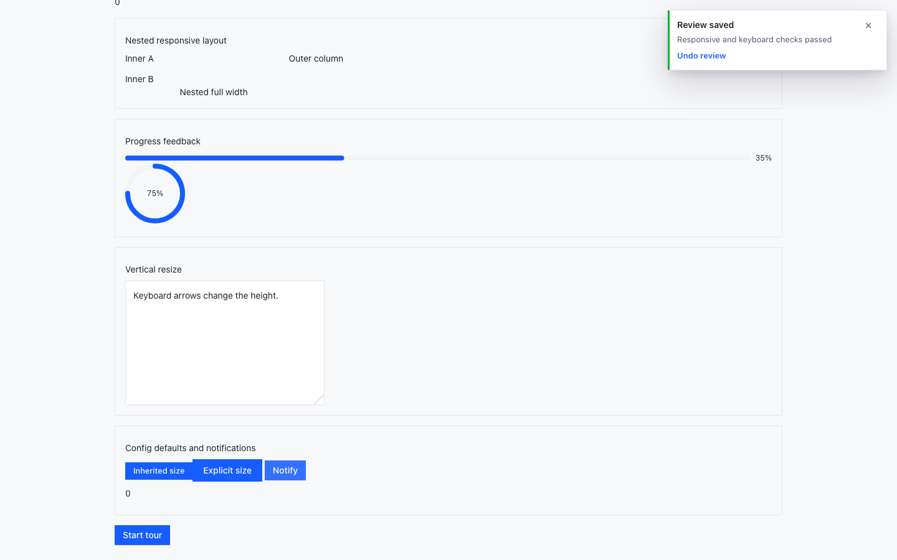
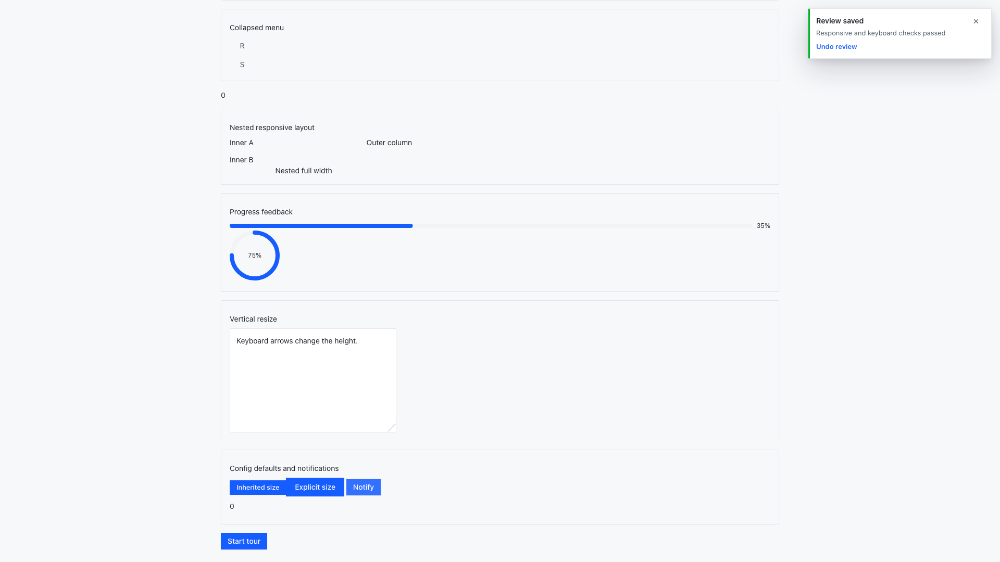

# PR #598 交互与模板证据

真实 Chromium 通过 `scripts/fixtures/enterprise-ui/playwright.parity-review.config.ts` 运行 6 个场景：

| 场景 | 结果 |
| --- | --- |
| Menu 键盘展开不触发选择、折叠菜单 hover/focus flyout | 通过 |
| Tour 首次正反向 Tab、Escape、滚动锁和焦点恢复 | 通过 |
| 嵌套 Grid/Col 断点计算与线型 Progress 信息 | 通过 |
| 垂直 ResizeBox、ConfigProvider 尺寸默认值、通知 action | 通过 |
| 1440x900 / 1920x1080 截图 | 通过 |

截图来自本地生产组件 fixture，UI 和 AI 样式同时加载；它们是本次 PR 的当前源码证据，不代表 npm 发布或线上部署验收。

当前 PR 正文同时记录了状态矩阵、`git diff --check` 和这两张独立截图链接。

