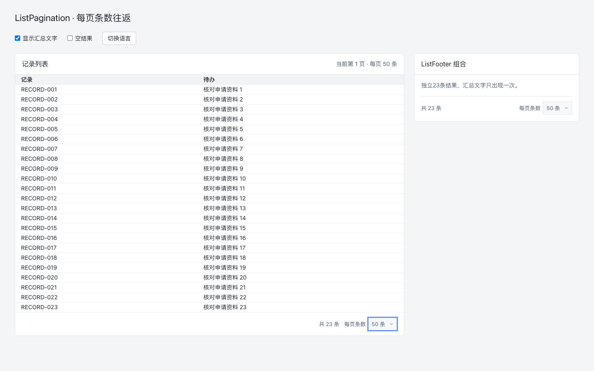
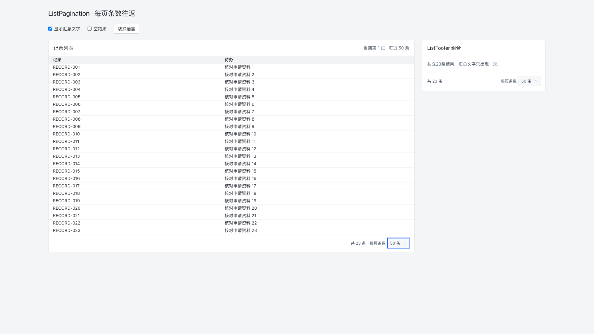

# ListPagination page-size recovery evidence

The fixture imports the actual source `ListPagination` and `ListFooter` components. The baseline uses the component from base commit `bcb2ea9f`; the final capture uses the PR component. Both show 23 constructed records at 50 rows per page.

| State matrix | Expected and verified |
| --- | --- |
| 23 records, 10 → 50 → 10 rows | Selector remains available and focus stays on it; changing back restores multiple pages. |
| One page with size callback | Selector visible; page numbers, previous/next and jumper absent. |
| Hidden summary | Configured selector remains available; count/range text absent. |
| Empty result | Selector remains available; no fake page navigation. |
| Single page without callback | Existing plain summary behavior retained by the component regression tests. |
| ListFooter | Selector visible independently of its hidden inner summary; total appears once. |
| Locale switch | Selector accessibility text updates between Chinese and English. |
| Loading/error/collapse | Not owned by this stateless pagination component; host behavior unchanged. |

Final results are in `after.json`: both `1440x900` and `1920x1080`, zero runtime/console/request errors and zero horizontal overflow. `mcp-diagnostics.json` records a call to the repository MCP handler's `svadmin_getDiagnostics` with the verified fixture browser observations. It is not a full application collector connection.




Before images: [1440x900](before-1440.png) / [1920x1080](before-1920.png). Additional empty/hidden-summary/English screenshots: [1440x900](states-1440.png) / [1920x1080](states-1920.png).

## Reproduce

After the repository's normal dependency/package setup, run:

```sh
bun --bun node_modules/.bin/vite --config scripts/fixtures/list-pagination-page-size/vite.config.ts --host 127.0.0.1 --port 5289 --strictPort
```

Open `http://127.0.0.1:5289/`, choose 50 rows for the main list, then choose 10 again. Toggle the summary and empty-result checkboxes and the language button. The sidebar exercises `ListFooter` independently. `capture.js` contains the Playwright CLI capture routine; remove its `export default` prefix, replace `__PHASE__` with `after`, and use an output path appropriate for the runner.

Validation: `bun run --cwd packages/ui test src/components/list-pagination.test.svelte.ts` (19 passed), targeted ESLint, `bun run check:vibe-governance`, and `git diff --check`. No full-suite, release or deployment claim.
