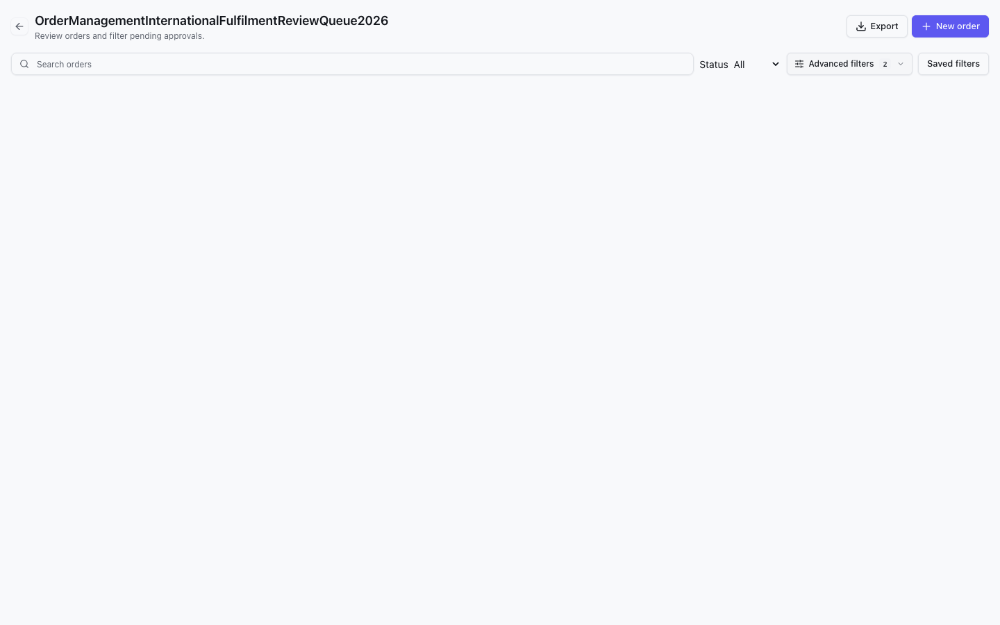
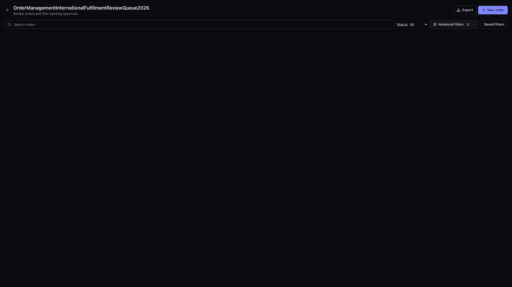

# UI Static CSS Migration

## Scope

Hosts can consume `@svadmin/ui/app.css` without a Tailwind build plugin.
Tailwind hosts use `app.theme.css` to retain semantic theme metadata alongside
the same precompiled styles. Public component props and variant helpers remain
compatible, including array and object class composition.

This is a progressive migration. Tailwind remains a build-time dependency and
974 transitional utility aliases remain in the build map. This change does not
claim a full handwritten-CSS rewrite or modify other packages' styling.

## Dark Mode Contract

The published CSS supports two equivalent dark-mode contracts:

```html
<html class="dark">
```

```html
<html data-color-scheme="dark">
```

`data-theme` remains reserved for brand/accent presets such as `neutral`,
`stripe`, `indigo`, and `blue`. This separation lets a host choose a dark color
scheme and a brand preset independently:

```html
<html data-color-scheme="dark" data-theme="neutral">
```

The selectors are implemented as
`:is(.dark, [data-color-scheme="dark"])`, so nested brand scopes keep working
without JavaScript. Hosts should also set `color-scheme: dark` on the same
element for native form controls and scrollbars.

Switch sizing is tokenized for dense and touch layouts:

```css
:root {
  --svadmin-switch-width: 2.25rem;
  --svadmin-switch-height: 1.25rem;
  --svadmin-switch-hit-area: 0.5rem;
}
```

The switch renders an invisible `::before` hit area using the hit-area token.
Coarse pointers automatically expand it to `0.75rem`. Hosts can override the
token without changing component markup.

## Svelte 5 and Bundler Imports

For CSS-only hosts, prefer the published static classes so no component code or
Tailwind compiler enters the host bundle:

```svelte
<input class="svadmin-input" />
<button class="svadmin-button svadmin-button--default svadmin-button-size--default">
  Save
</button>
```

For interactive Svelte components, import named primitives from the package
entry:

```svelte
<script lang="ts">
  import { Button } from '@svadmin/ui';
</script>

<Button variant="default" size="default">Save</Button>
```

Keep one CSS import per application:

```ts
import '@svadmin/ui/app.css';
```

Do not import both `app.css` and `app.theme.css` in the same host. Tailwind
hosts should use `app.theme.css`; non-Tailwind hosts should use `app.css`.

Vite 8 / Rolldown hosts that only need markup styles should avoid deep imports
from `@svadmin/core` source files. If a host imports the full package entry and
the optimizer pulls workspace source into the browser chunk, exclude the source
package from prebundling or switch the affected primitives to the documented
`svadmin-*` classes. Keep the import path stable so a future package export can
replace it without changing markup.

## PM Gate

JTBD: integrate the admin UI into an existing application without adopting a
specific host CSS compiler, while preserving theme overrides and daily workflows.

Anti-goals: no backend, authentication, persistence, package release, or deployment
changes. No redesign of the business workflows.

Information architecture: preserve the existing page header and breadcrumb
hierarchy. Keep advanced filters collapsed until requested and allow actions
and long titles to wrap at narrow widths.

## State Matrix

| Surface | States | Acceptance |
| --- | --- | --- |
| CSS entries | Plain CSS, theme CSS, Tailwind host | Compiled styles and host overrides remain available |
| Page chrome | Light/dark, compact/comfortable | Stable control sizing and readable text |
| Viewports | 1440x900, 1920x1080, 390x900 | No horizontal overflow or overlapping actions |
| Search | Empty, populated, cleared | Two-way query binding remains intact |
| Advanced filters | Collapsed, expanded | Matching region ID and ARIA controls; collapse unmounts panel |
| Navigation | Back action, desktop viewport | Callback runs; viewport honors Bits UI width |
| Alerts | With/without icon | No implicit blank grid column |
| Theme composition | Nested theme, host token override | Local semantic values and host utilities take precedence |
| Failure handling | Invalid migration input | Migration fails before writing files |

## Gherkin Acceptance

```gherkin
Scenario: Consume the UI without a host Tailwind plugin
  Given a Svelte host imports the published plain CSS entry
  When it renders the page header, breadcrumbs, and filter toolbar
  Then all component styles are available without a Tailwind compiler

Scenario: Clear and expand filters
  Given a populated search query and collapsed advanced filters
  When the user clears search and opens advanced filters
  Then the query binding is empty and the controlled region is mounted

Scenario: Preserve host theme customization
  Given a Tailwind host overrides a semantic color token and control utilities
  When the published theme entry is compiled by that host
  Then host styles override defaults and nested semantic themes still work

Scenario: Fail closed on invalid migration input
  Given a component contains invalid Svelte syntax
  When the maintenance migration is invoked
  Then validation fails before any component files are written
```

## Browser Evidence

The screenshots use the real `PageChromeHarness.svelte` fixture, mounted in
Chromium with the published plain CSS entry. Both entries were also checked
across all viewport and theme combinations above.



